# 15 — Diagrama de Atividades

**📌 Família:** comportamental · **Responde:** *qual é o passo a passo de um processo — quem faz
o quê, em que ordem, com quais decisões e o que pode acontecer ao mesmo tempo?*

> 🎯 **Meta desta aula:** ao final você vai saber **por que** este diagrama existe (e de onde ele
> veio), **ler** qualquer diagrama de atividades pensando em **fichas (tokens)** andando pelo
> fluxo, **desenhar** processos do **Melodia** com decisões, laços, paralelismo e **raias**, e —
> tão importante quanto — saber **quando NÃO usar**. No final, você aplica tudo no **projeto do
> seu grupo**.

---

## 🗺️ Roteiro da aula (sugestão para o professor)

| Bloco | Tempo | O que acontece | Seção |
|-------|-------|----------------|-------|
| 1. Provocação | 10 min | "Expliquem a cobrança mensal do Melodia **só com texto**" — e ver a confusão | [§1](#1-o-problema-que-o-diagrama-resolve) |
| 2. História | 10 min | De Gilbreth (1921) e von Neumann (1947) ao BPMN | [§2](#2-de-onde-veio-uma-história-de-100-anos) |
| 3. Modelo mental | 15 min | A **ficha (token)** que anda pelo fluxo | [§3](#3-o-modelo-mental-a-ficha-token) |
| 4. Notação | 20 min | Cada símbolo, um por um | [§4](#4-notação--cada-símbolo-um-por-um) |
| 5. Construção ao vivo | 30 min | "Reproduzir música" em 6 camadas, no quadro | [§5](#5-construindo-reproduzir-música--passo-a-passo) |
| 6. Repertório | 30 min | 7 processos do Melodia, cada um com um recurso novo | [§6](#6-mais-processos-do-melodia-ampliando-o-repertório) |
| 7. Armadilhas | 20 min | Os bugs de fork/join, decisão e "espaguete" | [§8](#8-como-não-usar--os-antipadrões) |
| 8. Prática | resto | Exercícios + aplicação no projeto do grupo | [§12](#12-exercícios-para-você-fazer) · [§13](#13-aplicando-no-projeto-do-seu-grupo) |

> 💡 Cabe em **dois encontros**: no 1º, §1–§5; no 2º, §6–§13.

---

## 1. O problema que o diagrama resolve

Imagine que o gerente de produto do Melodia mandou este texto para o time:

> *"Todo dia 1º a gente cobra quem tem plano pago. Se a pessoa tiver saldo, debita e agenda o
> próximo mês, senão suspende — a não ser que já esteja cancelada, aí nem cobra. Ah, e plano Free
> não paga, óbvio. Quando suspender, avisa o ouvinte e também manda pro financeiro, mas não precisa
> esperar o e-mail sair pra seguir cobrando os outros. E se o banco estiver fora do ar, tenta de
> novo depois."*

Agora responda, **sem reler**:

1. Uma assinatura **cancelada** é avisada?
2. O aviso ao ouvinte e o envio ao financeiro acontecem **em ordem** ou **ao mesmo tempo**?
3. O que acontece com quem **tem saldo**, mas o **banco caiu**? Volta para o início? Para a fila?
4. Quantos **caminhos diferentes** existem nesse processo? (Dica: quantos **testes** o QA precisa
   escrever?)

Texto corrido é **ótimo para contar história** e **péssimo para mostrar estrutura**. As palavras
"se", "senão", "a não ser que", "também", "não precisa esperar" e "tenta de novo" escondem
**decisões, paralelismo e laços** no meio da prosa. Cada leitor monta um processo diferente na
cabeça — e cada programador implementa um.

O **diagrama de atividades** existe para tirar essa estrutura da prosa e colocá-la **à vista**:

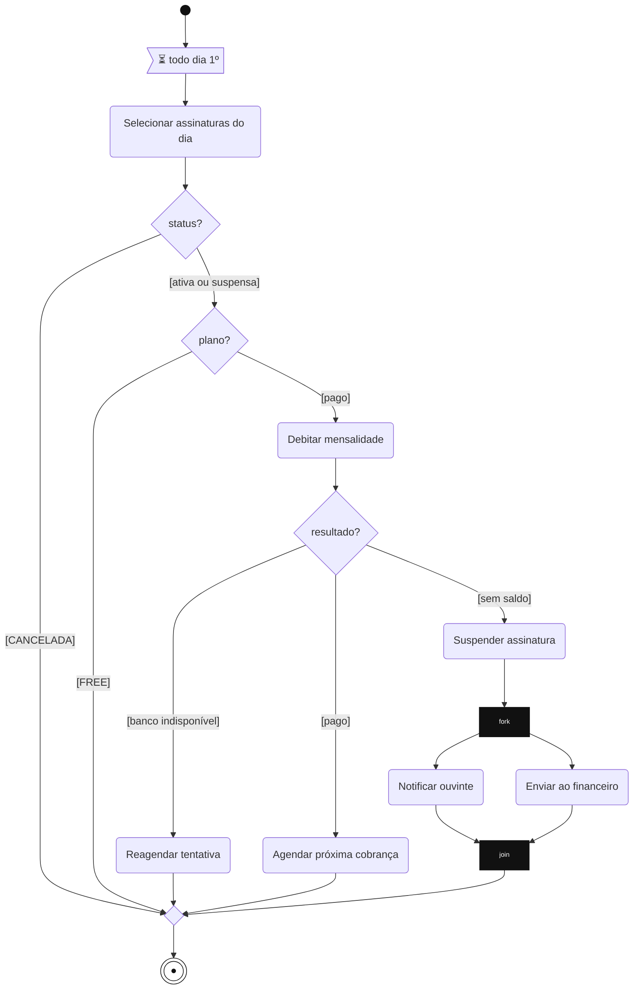

Agora as respostas **saltam aos olhos**: (1) cancelada vai direto ao fim — **não** é avisada;
(2) aviso e financeiro estão entre um **fork** e um **join** — são **paralelos**; (3) banco fora
do ar **reagenda** e encerra esta execução; (4) há **5 caminhos** do início ao fim → **5 cenários
de teste**, no mínimo.

> 🧭 **Analogia:** o texto do gerente é a **receita contada por telefone**; o diagrama é a
> **receita escrita em passos numerados, com "se a massa grudar, faça X"**. A comida é a mesma;
> a chance de errar, não.

### Os 5 motivos para usar (decore o "porquê")

| # | Motivo | No Melodia |
|---|--------|------------|
| 1 | **Tornar visível** a estrutura escondida na prosa (decisões, paralelismo, laços) | A regra de cobrança acima |
| 2 | **Alinhar pessoas** técnicas e não técnicas no **mesmo** desenho | Produto, financeiro e devs discutindo a cobrança |
| 3 | **Mostrar responsabilidades** — quem faz cada passo (raias) | Ouvinte × Plataforma × Banco |
| 4 | **Encontrar buracos** antes do código: caminhos sem fim, casos esquecidos | "E se o banco cair?" só aparece quando você desenha a decisão |
| 5 | **Derivar testes**: cada caminho do início ao fim é um cenário de teste | 5 caminhos → 5 testes da rotina de cobrança |

---

## 2. De onde veio: uma história de 100 anos

O diagrama de atividades **não foi inventado pela UML** — ela herdou e formalizou ideias muito
mais antigas. Conhecer essa linhagem explica **por que** a notação é do jeito que é.

| Ano | Marco | O que herdamos |
|-----|-------|----------------|
| **1921** | **Frank e Lillian Gilbreth** apresentam os *Process Charts* à ASME (Sociedade Americana de Engenheiros Mecânicos) para analisar trabalho em fábricas | A ideia de **desenhar um processo** como sequência de passos para **melhorá-lo** |
| **1947** | **Herman Goldstine e John von Neumann** usam *flow diagrams* para planejar programas do computador IAS | O **fluxograma de algoritmo**: caixas de ação + losangos de decisão |
| **1962** | **Carl Adam Petri** defende sua tese sobre comunicação entre autômatos — nascem as **Redes de Petri** | A semântica de **fichas (tokens)** e o **paralelismo** com sincronização |
| **1960s–70s** | Padronização dos símbolos de fluxograma (ANSI, depois ISO 5807) | Os **símbolos** que todo mundo reconhece |
| **1997** | **UML 1.1** (Booch, Rumbaugh, Jacobson / OMG) inclui o diagrama de atividades — mas como um **caso especial da máquina de estados** | O diagrama entra na UML, ainda "emprestado" |
| **2004–05** | **UML 2.0** reescreve o diagrama sobre uma semântica de **fluxo de tokens, inspirada em Redes de Petri** | Fork/join, raias, objetos, sinais e regiões com significado **preciso** |
| **2004 / 2011** | **BPMN** (BPMI, depois OMG; versão 2.0 em 2011) | O "primo" usado por áreas de negócio e motores de workflow |

> 🧠 **A grande virada da UML 2:** na UML 1.x, uma atividade era um "estado em que o objeto está
> fazendo algo". Na UML 2, ela virou um **grafo por onde fichas circulam**. Isso parece detalhe
> acadêmico, mas é o que permite responder com **rigor** perguntas como *"esse join pode travar?"*
> — e é por isso que a próxima seção é a mais importante da aula.

---

## 3. O modelo mental: a ficha (token)

Esqueça "setas e caixinhas" por um minuto. Pense num **jogo de tabuleiro**:

- O **nó inicial** coloca **uma ficha** no tabuleiro.
- A ficha **anda** pelas setas (fluxos).
- Uma **ação** só executa quando **recebe a ficha**; ao terminar, **passa a ficha adiante**.
- Uma **decisão** manda a ficha por **UM** caminho só (aquele cuja guarda é verdadeira).
- Um **fork** **clona** a ficha: entra 1, saem N (uma por ramo) → paralelismo.
- Um **join** **espera** chegar uma ficha de **CADA** ramo de entrada; só então solta **uma**.
- Um **merge** deixa passar **qualquer** ficha que chegar, **sem esperar** as outras.
- O **fim da atividade** (◉) **recolhe todas** as fichas do tabuleiro: acabou tudo.
- O **fim de fluxo** (⊗) recolhe **só aquela** ficha: aquele ramo morreu, os outros seguem.

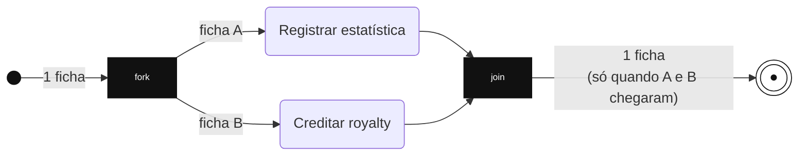

> ✅ **Regra de leitura de toda esta aula:** diante de qualquer diagrama, **coloque o dedo no
> nó inicial e ande com a ficha**. Se em algum momento a ficha **fica presa** (um join que espera
> um ramo que nunca vem) ou **não tem para onde ir** (nenhuma guarda verdadeira), o diagrama tem
> um **bug** — exatamente como um programa travado. Vamos caçar esses bugs na [§8](#8-como-não-usar--os-antipadrões).

---

## 4. Notação — cada símbolo, um por um

### 4.1 Os essenciais (90% dos diagramas usam só estes)

| Símbolo UML | Nome | O que significa | Regra prática |
|-------------|------|-----------------|---------------|
| ● | **Nó inicial** | Onde a ficha nasce | Normalmente **um** por atividade |
| ▢ (cantos arredondados) | **Ação** | Um passo de trabalho, **atômico** naquele nível | Nome **verbo no infinitivo + objeto**: *"Debitar mensalidade"* |
| → | **Fluxo de controle** | A ficha anda de um nó a outro | Pode ter **guarda** `[condição]` |
| ◇ (com 1 entrada, N saídas) | **Decisão** | A ficha segue **um** caminho só | Guardas **exclusivas** e **completas** (use `[senão]`) |
| ◇ (com N entradas, 1 saída) | **Merge** | Junta caminhos **alternativos** | **Não espera** ninguém |
| ▬ (1 entrada, N saídas) | **Fork** | Divide em fluxos **paralelos** | Todos os ramos executam |
| ▬ (N entradas, 1 saída) | **Join** | Sincroniza os paralelos | **Espera todos** os ramos |
| ◉ | **Fim da atividade** | Termina **tudo** | Pode haver mais de um |
| ⊗ | **Fim de fluxo** | Termina **só este ramo** | Útil em ramos paralelos |
| colunas/faixas | **Raias** (*partitions / swimlanes*) | **Quem** executa cada ação | Uma raia = um papel, setor ou sistema |

> ⚠️ **O par que mais confunde:** losango e barra. **Losango = "OU"** (um caminho ou outro).
> **Barra = "E"** (todos os caminhos ao mesmo tempo). Trocar um pelo outro é o erro nº 1 da
> disciplina.

| | Decisão / Merge ◇ | Fork / Join ▬ |
|---|-------------------|---------------|
| Lógica | **OU** exclusivo | **E** (todos) |
| Fichas que saem | **1** | **N** (uma por ramo) |
| Na entrada (merge × join) | passa a **primeira** que chegar | **espera todas** |
| Em Java | `if / else`, `switch` | threads, `CompletableFuture`, tarefas paralelas |

### 4.2 Os avançados (aparecem em processos reais)

| Símbolo UML | Nome | O que significa | Exemplo no Melodia |
|-------------|------|-----------------|--------------------|
| ▭ (retângulo reto) | **Nó de objeto** | Um **dado/artefato** que flui entre ações | `📄 Fatura`, `🎵 Arquivo de áudio` |
| ⧗ (ampulheta) | **Evento de tempo** | A atividade começa/continua por **tempo** | *"todo dia 1º"*, *"após 3 dias"* |
| ⏵ (pentágono convexo) | **Enviar sinal** | Dispara uma mensagem e **segue** | *"Enviar e-mail de boas-vindas"* |
| ⏴ (pentágono côncavo) | **Receber sinal** | **Espera** uma mensagem externa chegar | *"Receber confirmação do Pix"* |
| ⋔ (tridente na ação) | **Chamada de atividade** | A ação é **outra atividade inteira**, detalhada em outro diagrama | *"⋔ Cobrar assinatura"* |
| ▭ tracejado + ↯ | **Região interrompível** | Se um evento ocorrer, **aborta** tudo lá dentro | Ouvinte **cancela** o cadastro no meio |
| ▭ tracejado com «iterative»/«parallel» | **Região de expansão** | Executa o miolo **para cada** item de uma coleção | *"para cada faixa do álbum"* |
| 📝 «precondition» / «postcondition» | **Notas de contrato** | O que vale antes/depois da atividade | *"ouvinte autenticado"* |

### 4.3 A colinha da sintaxe no Mermaid

O Mermaid **não tem** um tipo nativo "diagrama de atividades UML", então usamos o `flowchart`
com **convenções fixas**. Todos os diagramas desta aula seguem esta tabela:

| Você quer… | Escreve no Mermaid | Aparece como |
|------------|--------------------|--------------|
| Nó inicial ● | `INI(( )):::ini` | círculo preto |
| Fim da atividade ◉ | `FIM((("●"))):::fim` | círculo duplo com ponto |
| Fim de fluxo ⊗ | `X(("✕"))` | círculo com X |
| Ação | `A("Debitar mensalidade")` | retângulo arredondado |
| Decisão / merge | `D{"saldo?"}` / `M{" "}` | losango |
| Guarda | `D -->\|"[saldo ≥ preço]"\| A` | texto na seta |
| Fork / join | `F["fork"]:::bar` | barra preta |
| Nó de objeto | `O["📄 Fatura"]` | retângulo reto |
| Evento de tempo / sinal | `T>"⏳ todo dia 1º"]` · `S>"📤 Enviar e-mail"]` | bandeira |
| Raia | `subgraph R1["🏦 Banco"] ... end` | faixa com título |
| Chamada de atividade ⋔ | `C("⋔ Cobrar assinatura")` | ação com tridente |

E as três linhas de estilo que vão no fim de cada diagrama:

```text
classDef ini fill:#111,stroke:#111,color:#fff
classDef fim fill:#fff,stroke:#111,color:#111
classDef bar fill:#111,stroke:#111,color:#fff,font-size:10px
```

> ✍️ Cole qualquer bloco ` ```mermaid ` desta aula no [mermaid.live](https://mermaid.live) e
> edite. Para a **notação UML oficial** (pentágonos, ampulheta, regiões tracejadas), use
> [draw.io](https://app.diagrams.net) (biblioteca *UML*) ou PlantUML (`@startuml ... start ...
> stop`), que têm os símbolos nativos.

> 📐 **Sobre o texto no losango:** pela UML "pura", a decisão é um losango **vazio** e as
> condições ficam **só** nas guardas das setas. Escrever uma pergunta curta dentro do losango
> (*"saldo?"*) é uma convenção aceita (a UML chama de *decision input*) e **ajuda muito** a ler.
> Nesta aula usamos as duas coisas: pergunta no losango **e** guardas nas setas.

---

## 5. Construindo "Reproduzir música" — passo a passo

Vamos desenhar o processo do caso de uso **Reproduzir música** (da
[aula 08](../08-diagrama-casos-de-uso/)) em **camadas**, igual fizemos na
[aula de sequência](../11-diagrama-de-sequencia/). A referência é o método real
`PlataformaStreaming.reproduzir(...)` do [projeto-base-java](../projeto-base-java/).

### Passo 1 — A linha reta (o "caminho feliz")

Comece **sempre** pelo caminho em que tudo dá certo. Sem decisões, sem exceções.

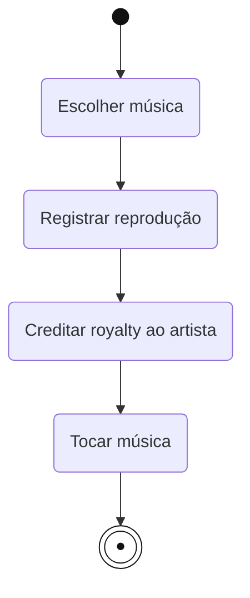

**O que temos?** Início, quatro **ações** (todas *verbo + objeto*) e fim. Já é um diagrama de
atividades válido — e já serve para conversar: *"é isso que acontece quando alguém aperta play?"*

### Passo 2 — A primeira decisão (o `if` de guarda)

O código real começa com `if (!catalogo.contains(musica)) return "✗ Música fora do catálogo";`.
Isso é uma **decisão** com dois caminhos — e um deles termina **cedo**.

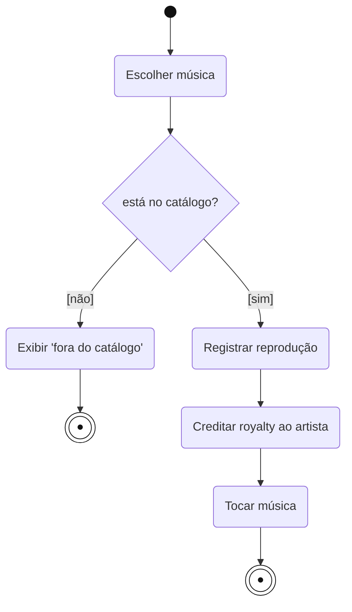

**Por quê?** Toda decisão tem **guardas** nas saídas (`[sim]`/`[não]`). Repare que pode haver
**mais de um fim**: o caminho de erro termina por conta própria. É o `return` antecipado — o mesmo
`break` da [aula de sequência](../11-diagrama-de-sequencia/), agora em forma de fluxo.

### Passo 3 — Decisão + merge (o `if` que volta a juntar)

Plano FREE ouve um **anúncio** antes; Premium ativo, não. Depois disso, **os dois caminhos voltam
a ser um só**. Quem junta caminhos alternativos é o **merge** (losango vazio).

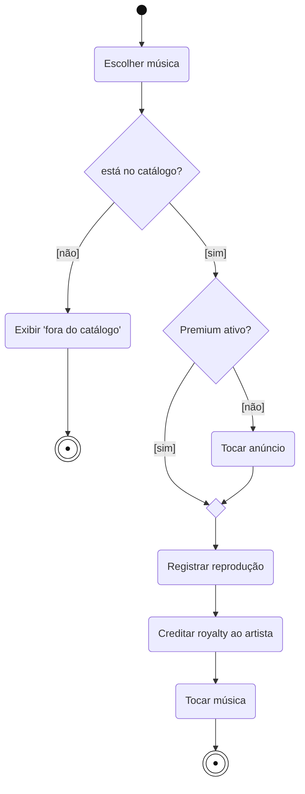

**Por quê o merge?** Sem ele, você teria duas setas chegando direto em *Registrar reprodução*.
E aqui mora uma pegadinha da UML 2: **várias setas entrando numa ação = join implícito** — a ação
**esperaria uma ficha de cada seta**. Como só um dos caminhos acontece (ou tem anúncio, ou não
tem), a segunda ficha **nunca chega** e o processo **trava**. O losango vazio deixa **explícito**:
*"aqui os caminhos alternativos se reencontram, siga com a primeira ficha que chegar"*. É o `}` que
fecha o `if` no código.

> ⚠️ **Regra de ouro:** **nunca** ligue duas setas direto numa **ação**. Caminhos alternativos →
> **merge** ◇ antes. Caminhos paralelos → **join** ▬ antes. (Nós de **fim** podem receber várias
> setas sem problema.)

### Passo 4 — O laço (o `for` dos royalties)

Uma música pode ter **vários artistas** (feat.). O royalty é creditado **para cada um**. Laço em
diagrama de atividades = **decisão que volta para trás**.

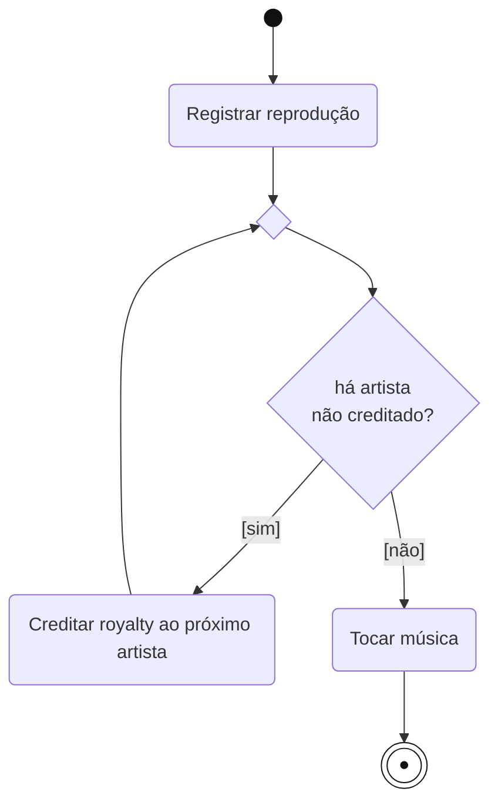

**Por quê?** O **merge** no topo recebe a ficha **na primeira vez** e **a cada volta**; a
**decisão** testa a condição de parada. É exatamente `for (Artista a : artistas) { ... }`. Em
diagramas maiores, prefira a **região de expansão** (*"para cada artista"*, veja [§6.3](#63--publicar-álbum-objetos--região-de-expansão--fork)) — fica mais limpo.

### Passo 5 — Raias: quem faz o quê

Até aqui não sabemos **quem** executa cada passo. As **raias** respondem isso. Três participantes:
o **Ouvinte**, a **Plataforma** e o **Catálogo/Artista**.

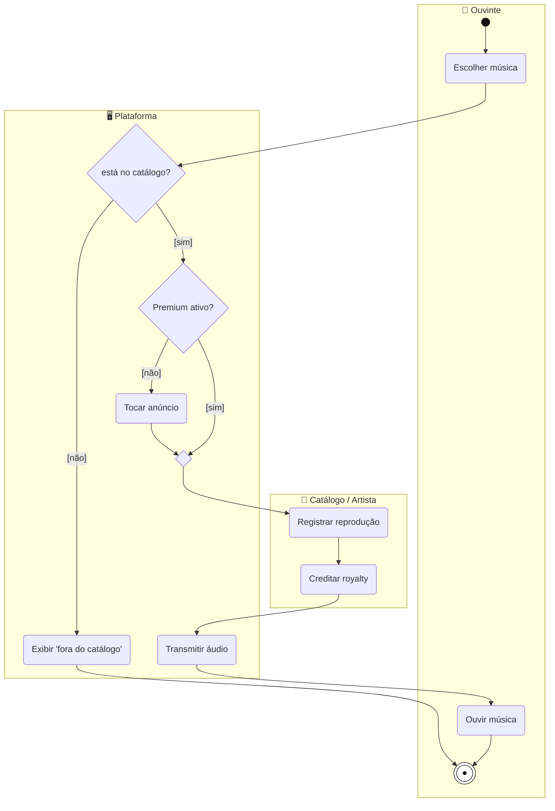

**Por quê?** Agora o diagrama mostra **responsabilidade** e **passagens de bastão** (cada seta que
**atravessa** uma raia é uma **entrega** de um participante para outro — é ali que moram atrasos,
falhas de integração e "não era comigo"). Em análise de processos, contar as **travessias de raia**
é uma métrica clássica: muitas travessias = processo burocrático.

> 🔎 Ligação com a [aula de sequência](../11-diagrama-de-sequencia/): cada travessia de raia
> costuma virar **uma mensagem** entre participantes no diagrama de sequência. Atividades mostra
> o **processo**; sequência mostra a **conversa**.

### Passo 6 — Paralelismo com fork/join

*Registrar reprodução* e *Creditar royalty* **não dependem um do outro**. Num streaming de verdade,
com milhões de plays por minuto, fazê-los **ao mesmo tempo** economiza tempo. Isso é **fork/join**.

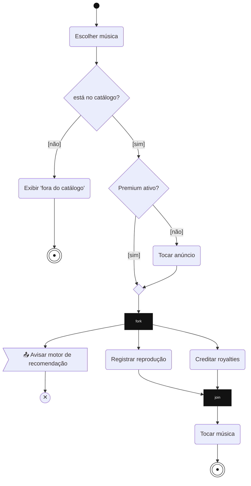

**O que há de novo — e por quê:**
- O **fork** clona a ficha em **três**. As três ações rodam em paralelo.
- O **join** espera **só** *Registrar* e *Creditar* — porque a música só deve tocar depois que o
  play foi contabilizado (regra de negócio: não pode haver play sem royalty).
- O aviso ao motor de recomendação é um **sinal enviado** ("dispara e segue") e termina num
  **fim de fluxo ⊗**: aquele ramo morre sozinho, **sem** segurar o join e **sem** encerrar a
  atividade. Se tivéssemos usado ◉ ali, a ficha que chegasse primeiro **mataria tudo** —
  inclusive a música tocando!

> 🧠 Esse último ponto é a diferença mais sutil (e mais cobrada em prova) da notação:
> **◉ = acabou o processo inteiro; ⊗ = acabou este fio.**

### 🏁 Diagrama completo "Reproduzir música" (com raias + paralelismo)

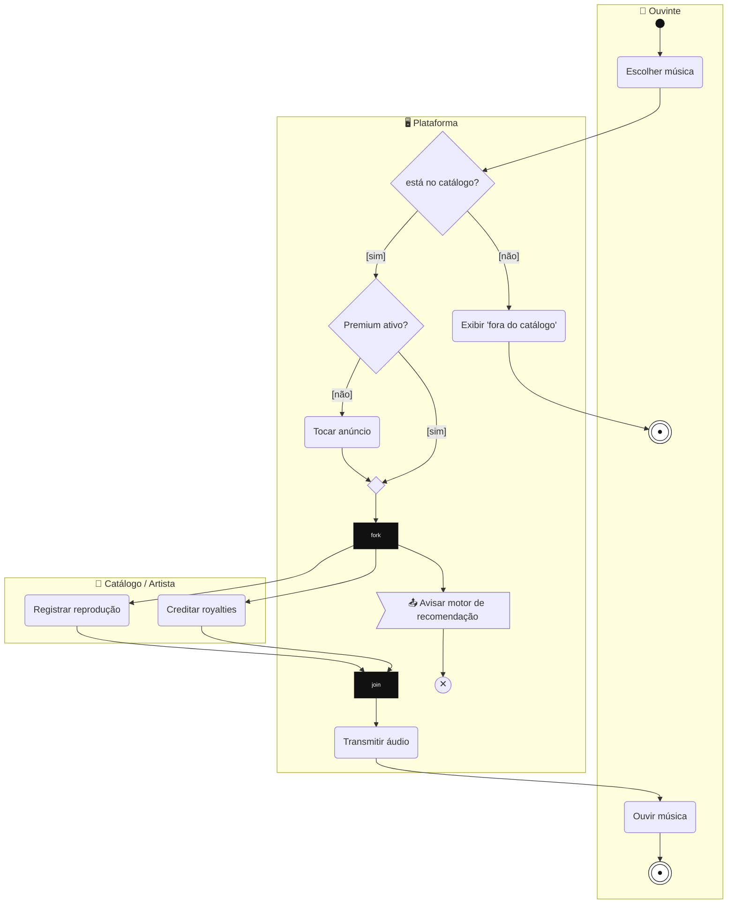

> 🔎 **Exercício de leitura (faça com a turma):** coloque o dedo no ● e ande com a ficha pelo caso
> do **Lucas (FREE)** e depois pelo da **Ana (Premium)**. Quantas fichas existem no tabuleiro logo
> depois do fork? *(Resposta: 3.)* E logo depois do join? *(1 — mais a do sinal, se ainda não
> morreu no ⊗.)*

---

## 6. Mais processos do Melodia (ampliando o repertório)

Cada processo abaixo introduz **um recurso novo** da notação. Leia o diagrama **antes** do texto
e tente explicá-lo em voz alta — é o melhor treino para prova e para entrevista.

### 6.1 — Cobrança mensal (evento de tempo + região de expansão + `try again`)

O **ator de tempo** `⏰ Sistema de Cobrança` da [aula 08](../08-diagrama-casos-de-uso/) dispara
sozinho. O miolo roda **para cada assinatura** — isso é uma **região de expansão** (o retângulo
tracejado, «iterative» = uma de cada vez). É o `Assinatura.cobrar(conta)` do projeto, dentro de um
laço.

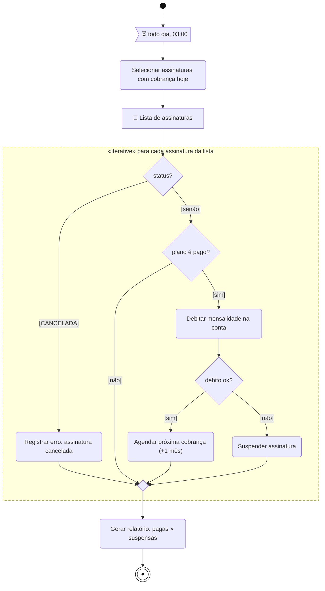

**O que há de novo?**
- **Evento de tempo** (`⏳`): ninguém clicou em nada — o **relógio** iniciou a atividade.
- **Nó de objeto** (`📄 Lista de assinaturas`): mostra o **dado** que flui entre as ações.
- **Região de expansão**: em vez de desenhar um laço com merge+decisão (Passo 4), dizemos
  *"o que está aqui dentro roda para cada item"*. Muito mais limpo. Se fosse «parallel», as
  assinaturas seriam cobradas **ao mesmo tempo** (a escolha é de **projeto**: paralelo é mais
  rápido, mas sobrecarrega o banco).
- O ramo `[CANCELADA]` corresponde ao `throw new IllegalStateException(...)` de `cobrar()`: a
  rotina em lote **não pode** parar por causa de uma assinatura — então ela **registra o erro e
  segue**. Essa é uma decisão de projeto que **só aparece quando se desenha**.

### 6.2 — Assinar Premium (raias + objeto + chamada de atividade ⋔)

O mesmo cenário da [aula de sequência](../11-diagrama-de-sequencia/), agora como **processo**.
Três raias: **Ouvinte**, **Plataforma** e **Banco**.

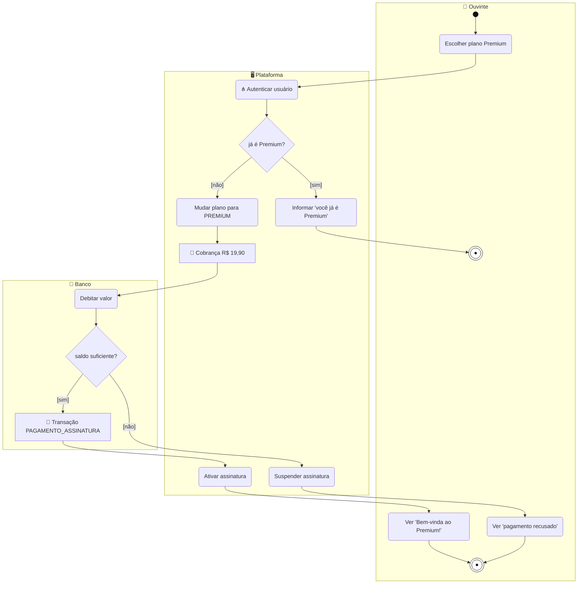

**O que há de novo?**
- **⋔ Autenticar usuário** é uma **chamada de atividade**: a autenticação é um processo inteiro,
  desenhado em **outro** diagrama. É o equivalente do `«include» Autenticar` dos casos de uso e
  do `ref` da sequência — **reúso sem cópia**.
- **Nós de objeto** na fronteira entre raias (`📄 Cobrança`, `📄 Transação`) mostram **o que é
  entregue** de um participante ao outro. Em processos de negócio, isso costuma ser um
  **documento** (nota, contrato, comprovante).
- Os ramos de *Banco* correspondem exatamente ao `debitarAssinatura(...)` que devolve
  `true/false`, e o ramo `[não]` é o **fluxo alternativo 2a** do caso de uso *Assinar plano*.

### 6.3 — Publicar álbum (objetos + região de expansão + fork)

O **Artista** envia um álbum. Cada faixa precisa ser **convertida** para vários formatos (isso
pode rodar **em paralelo**), enquanto capa e metadados são validados. No fim, há **moderação** —
que pode devolver o álbum para correção (um laço **de negócio**, não de código).

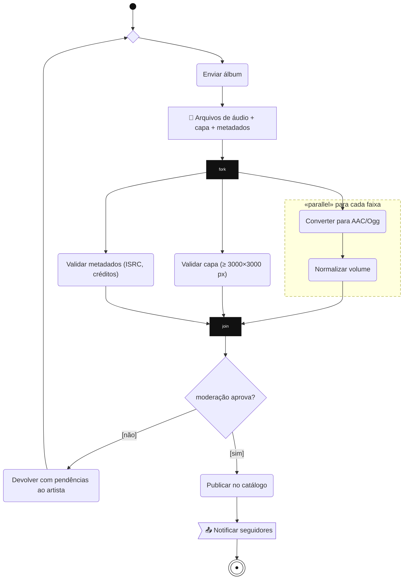

**O que há de novo?**
- **Expansão «parallel»** dentro de um ramo de **fork**: duas formas de paralelismo juntas. As
  faixas são convertidas **simultaneamente**, e isso tudo ainda corre **ao lado** das validações
  de capa e metadados.
- O **merge** antes de *Enviar álbum* recebe a ficha da primeira tentativa **e** a de cada reenvio —
  é ele que evita o join implícito (lembra da regra de ouro do Passo 3?).
- O **laço de correção** (*"Devolver com pendências"* → *"Enviar álbum"*) é um **laço de processo**:
  pode levar dias, envolve uma pessoa. Diagramas de atividades são perfeitos para mostrar esse tipo
  de **retrabalho** — e o retrabalho é exatamente o que gestores querem **medir e reduzir**.
- Ligação com a [aula 02](../02-conceitos-orientacao-objetos/): `Album` **compõe** suas faixas (◆).
  O diagrama de classes diz que *as faixas pertencem ao álbum*; o de atividades diz *como elas
  entram no sistema*.

### 6.4 — Período de teste grátis (sinal recebido + evento de tempo + região interrompível)

Novo ouvinte ganha **30 dias de Premium grátis**. Ao fim do prazo, é cobrado automaticamente —
**a não ser que cancele antes**. "A qualquer momento, se X, aborte" é o caso de uso da **região
interrompível**.

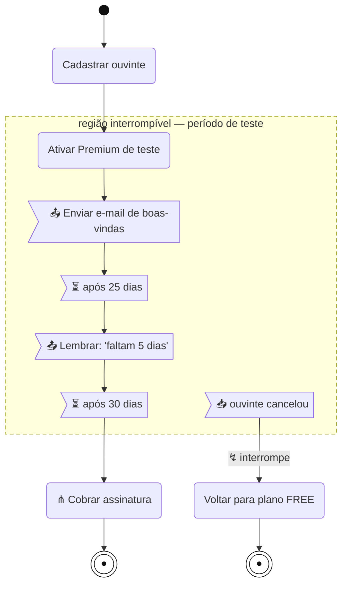

**O que há de novo?**
- **Eventos de tempo relativos** (`⏳ após 25 dias`): a ficha **fica parada** ali até o tempo
  passar. Isso modela "esperas" de negócio que o código implementa com **agendadores**.
- **Sinal recebido** (`📥 ouvinte cancelou`): um evento **externo** que pode chegar a qualquer
  momento.
- **Região interrompível** (tracejada) + seta **↯**: se o sinal chegar enquanto houver ficha lá
  dentro, **todas** as fichas da região são descartadas e o fluxo sai pela seta ↯. Sem esse
  recurso, você teria que desenhar um losango *"cancelou?"* **depois de cada passo** —
  espaguete garantido.

> 🧠 **Repare:** este é o tipo de regra que gera **processos judiciais** quando implementada
> errado (cobrar quem cancelou). Desenhar a região interrompível força o time a perguntar:
> *"e se ele cancelar entre o dia 30 e a cobrança efetiva?"*

### 6.5 — Sacar royalties (decisão com 3 saídas + espera por sinal com timeout)

O **Artista** pede o saque. Há um **valor mínimo** e o banco responde **de forma assíncrona**
(como um Pix que confirma segundos depois — ou não confirma).

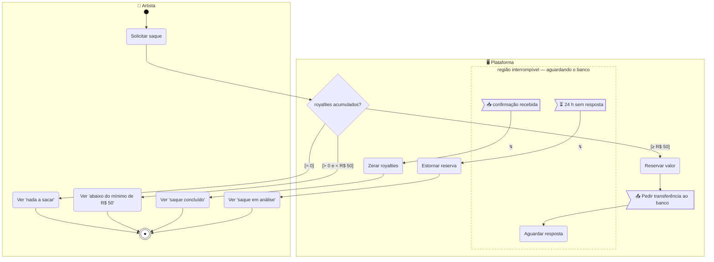

**O que há de novo?**
- Decisão com **três guardas** — e elas são **exclusivas** (`= 0`, `> 0 e < 50`, `≥ 50`, sem
  sobreposição) e **completas** (cobrem todos os valores). Esse é o teste que todo losango deve
  passar.
- Depois de *Pedir transferência*, o processo **espera** o que vier primeiro: a **confirmação**
  ou o **timeout de 24 h**. Os dois eventos estão **dentro** de uma região interrompível: o que
  disparar primeiro sai pela seta ↯ e **cancela o outro**. Se tivéssemos ligado
  *Pedir transferência* direto aos dois (sem a região), seria um **fork implícito**: as duas fichas
  existiriam e, 24 h depois de um saque **confirmado**, o sistema **estornaria** o dinheiro! Essa
  **corrida entre dois eventos** é onipresente em integrações (pagamentos, APIs externas).
- Note o **estorno**: em sistemas financeiros, **todo** caminho de falha precisa desfazer o que
  o caminho de sucesso fez. Desenhar os dois lados lado a lado deixa isso evidente.

### 6.6 — "Descobertas da Semana" (pipeline de dados)

Toda segunda-feira, o Melodia gera uma playlist personalizada **para cada ouvinte**. Este é um
**pipeline de dados** — e pipelines são, literalmente, diagramas de atividades executáveis.

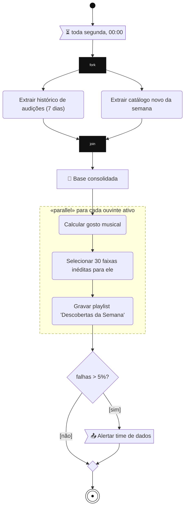

> 💼 Ferramentas como **Apache Airflow**, **AWS Step Functions** e **GitHub Actions** descrevem
> exatamente este grafo: tarefas, dependências (join), paralelismo (fork) e agendamento (evento de
> tempo). Quem entende diagrama de atividades **lê um DAG do Airflow de primeira**.

### 6.7 — Reembolso: processo de negócio AS-IS × TO-BE

O uso **mais comum** do diagrama na indústria nem envolve código: é **mapear um processo humano**
como ele é hoje (**AS-IS**) para depois redesenhá-lo (**TO-BE**). Exemplo: ouvinte cobrado em
dobro pede reembolso.

**AS-IS (hoje — manual):**

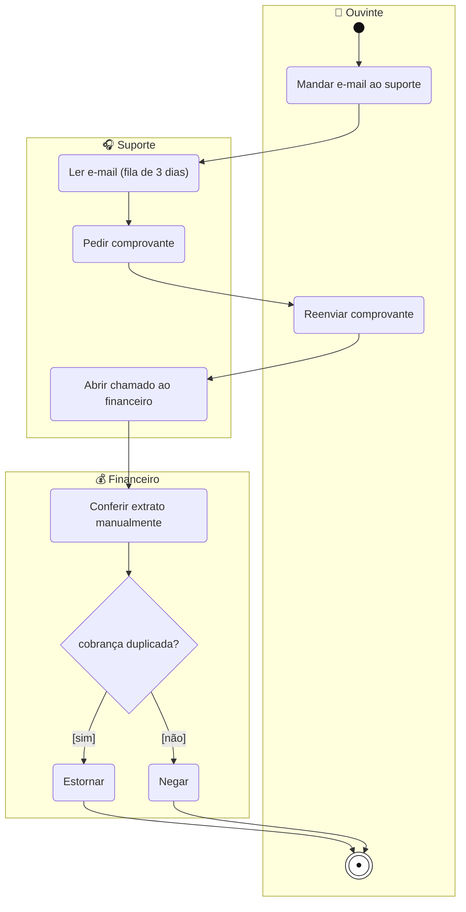

**TO-BE (proposto — automatizado):**

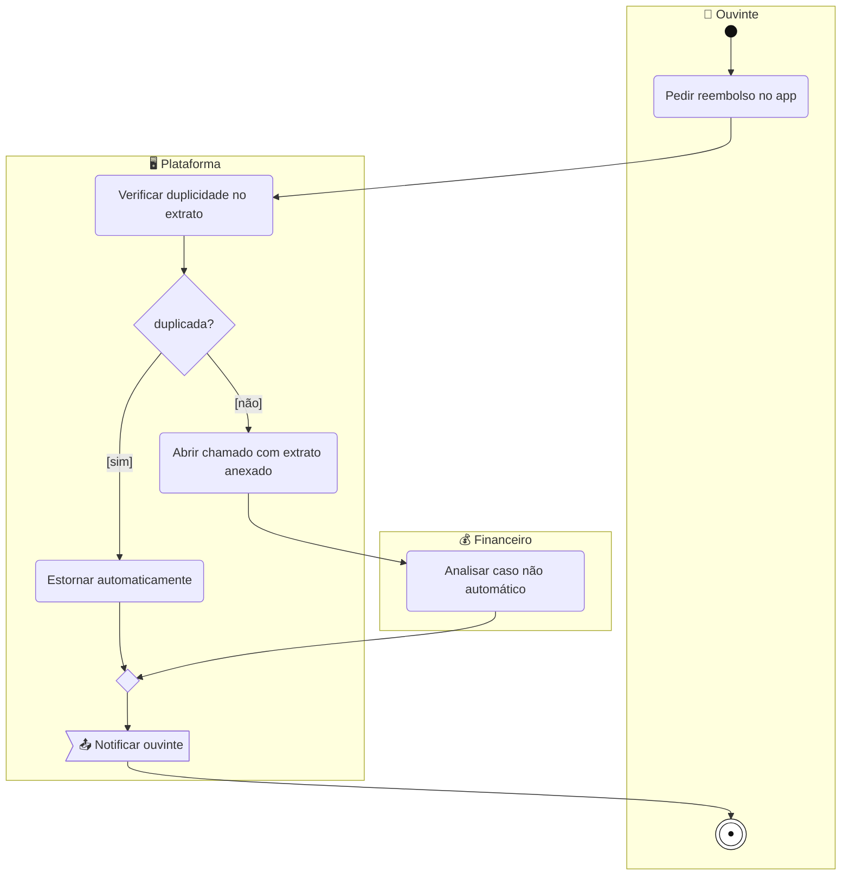

> 📊 **Compare os dois com números** (é assim que se vende um projeto de automação):
> o AS-IS tem **7 ações** e **5 travessias de raia** no caminho principal; o TO-BE tem **4 ações**
> e **2 travessias**. O diagrama virou **argumento de negócio** — e o caminho `[não]` mostra que o
> humano continua no processo para os casos difíceis.

---

## 7. Atividades × os outros diagramas (não confunda)

### O mesmo cenário em quatro lentes

Pegue **"Assinar Premium"** e veja o que cada diagrama enxerga:

| Diagrama | Pergunta | O que mostra de "Assinar Premium" | Aula |
|----------|----------|-----------------------------------|------|
| **Casos de uso** | *O quê* e *para quem*? | Uma elipse *Assinar plano* ligada ao *Ouvinte*, com `«include» Autenticar` | [08](../08-diagrama-casos-de-uso/) |
| **Atividades** | Qual o **processo**, quem faz cada passo? | Ações, decisão do saldo, raias Ouvinte/Plataforma/Banco | **15** |
| **Sequência** | Quais **objetos** trocam quais **mensagens**, em que ordem? | `UI → PlataformaStreaming → Assinatura → ContaBancaria`, com `alt` | [11](../11-diagrama-de-sequencia/) |
| **Máquina de estados** | Por quais **estados** um **objeto** passa? | `Assinatura`: ATIVA → SUSPENSA → ATIVA / CANCELADA | [14](../14-diagrama-de-maquina-de-estados/) |
| **Classes** | Quais **estruturas** existem? | `Ouvinte`, `Assinatura`, `Plano`, `ContaBancaria` e suas ligações | [09](../09-diagrama-de-classes/) |

### Atividades × Estados — a confusão mais comum

Os dois têm "caixinhas arredondadas e setas", mas pensam **ao contrário**:

| | Atividades | Máquina de estados |
|---|------------|--------------------|
| A caixa é… | uma **ação** (algo que **se faz**: *"Debitar"*) | um **estado** (algo que **se está**: *SUSPENSA*) |
| A seta dispara quando… | a ação **termina** | um **evento** acontece |
| Foco | um **processo** (pode envolver muitos objetos) | **um** objeto ao longo da vida |
| Nome típico | verbo: *"Suspender assinatura"* | adjetivo/particípio: *"Suspensa"* |

> ✅ **Teste rápido:** leia o nome da caixa em voz alta. Soou como **ordem** ("Suspender!")? É
> atividade. Soou como **condição** ("está Suspensa")? É estado.

### Atividades × Sequência

| | Atividades | Sequência |
|---|------------|-----------|
| Unidade | **passo** de processo | **mensagem** entre objetos |
| Quem faz | raias (papéis, setores, sistemas) | lifelines (objetos concretos) |
| Bom para | **visão de ponta a ponta**, regras de negócio, processos com pessoas | **detalhe técnico** de uma interação, APIs, integrações |
| Ruim para | detalhar chamadas de método | mostrar processos longos com pessoas e esperas de dias |

### Qual diagrama eu desenho? (um diagrama de atividades para escolher diagramas 😉)

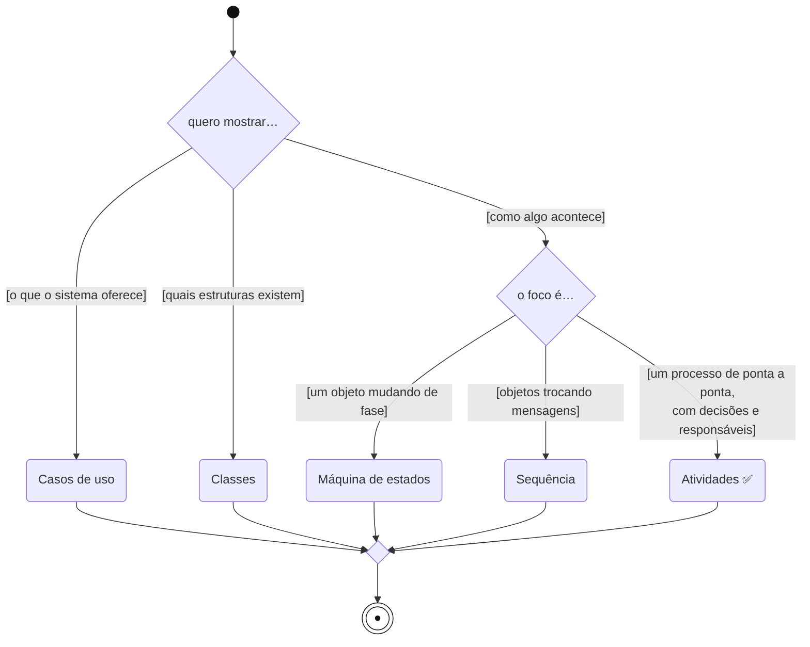

---

## 8. Como NÃO usar — os antipadrões

Esta seção vale ouro: a maioria dos diagramas de atividades ruins que você vai encontrar na vida
profissional comete **um destes erros**. Para cada um: o diagrama errado, o porquê, e a correção.

### ❌ Antipadrão 1 — O join que espera para sempre (deadlock)

Alguém quis "juntar tudo no final" e usou uma **barra** depois de uma **decisão**:

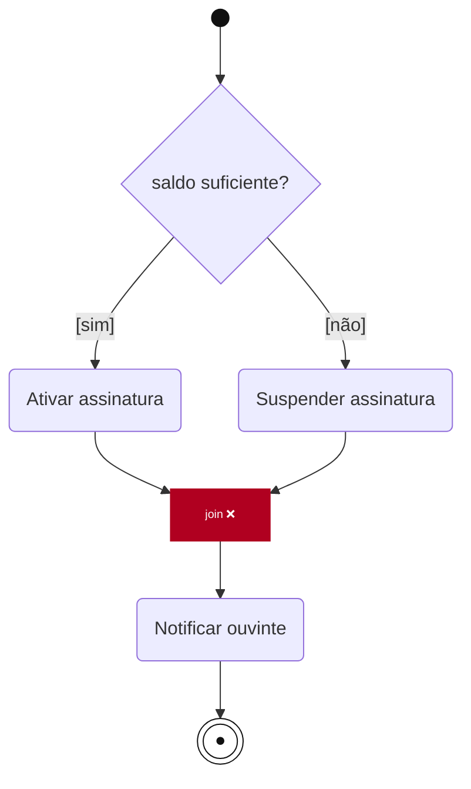

**Ande com a ficha:** a decisão manda **uma** ficha para *Ativar* **ou** para *Suspender*. O join
espera **as duas**. A segunda nunca vem → o ouvinte **nunca** é notificado. É o equivalente
visual de um **deadlock**. **Correção:** troque a barra por um **merge** ◇.

> 🧠 **Regra:** depois de **decisão**, feche com **merge**. Depois de **fork**, feche com **join**.
> Os pares não se misturam.

### ❌ Antipadrão 2 — Fork usado como "ou"

O inverso: queria dizer "um ou outro", desenhou uma **barra**:

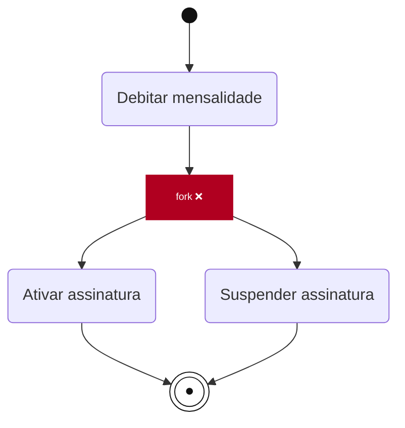

**Ande com a ficha:** o fork **clona** → a assinatura é **ativada E suspensa** ao mesmo tempo. O
estado final depende de qual terminar por último — uma **condição de corrida** desenhada à mão.
**Correção:** losango de **decisão** com guardas `[saldo ok]` / `[sem saldo]`.

### ❌ Antipadrão 3 — Guardas sobrepostas ou incompletas

```text
◇ ──[saldo > preço]──▶ Ativar
  └─[saldo < preço]──▶ Suspender
```

E se `saldo == preço`? **Nenhuma** guarda é verdadeira → a ficha **fica presa** no losango. E se
as guardas fossem `[saldo ≥ preço]` e `[saldo ≤ preço]`? Com `saldo == preço`, **as duas** são
verdadeiras → comportamento **indefinido**. **Correção:** guardas **mutuamente exclusivas** e
**completas** — e, na dúvida, termine com `[senão]`.

> 🔎 Isso não é preciosismo: o `debitarAssinatura` do projeto usa `if (saldo < valor) return
> false;` — ou seja, `saldo == valor` **paga**. O diagrama tem que dizer **exatamente** isso.

### ❌ Antipadrão 4 — Fim da atividade num ramo paralelo

Já vimos no [Passo 6](#passo-6--paralelismo-com-forkjoin): colocar ◉ num ramo que corre em
paralelo **mata todos** os outros ramos quando a primeira ficha chega lá. Se o ramo só "acaba",
use ⊗ (**fim de fluxo**).

### ❌ Antipadrão 5 — Misturar níveis de abstração

```mermaid
flowchart TB
    INI(( )):::ini --> A("Clicar no botão 'Assinar'")
    A --> B("Processar assinatura")
    B --> C("saldo = saldo - 19.90")
    C --> D("Fazer o marketing do plano")
    D --> FIM((("●"))):::fim

    classDef ini fill:#111,stroke:#111,color:#fff
    classDef fim fill:#fff,stroke:#111,color:#111
```

Uma ação de **interface** (clicar), uma **enorme e vaga** (processar assinatura), uma **linha de
código** (`saldo = …`) e uma de **estratégia da empresa** (marketing) no mesmo desenho. Ninguém
consegue ler — o gerente não entende a linha de código e o dev não sabe o que "processar" faz.
**Correção:** escolha **um nível** por diagrama (veja a [§10](#10-onde-usar--os-quatro-níveis))
e use **⋔ chamada de atividade** para descer de nível em outro diagrama.

### ❌ Antipadrão 6 — O espaguete

Um diagrama com 60 ações, 25 losangos e setas cruzando a tela inteira. Sinais clássicos:

- você precisa **dar zoom** para ler;
- setas **voltam** para lugares distantes (*goto* visual);
- ninguém do time **atualizou** desde que foi desenhado.

**Correção:** **decomponha**. Cada bloco coeso vira uma atividade própria e entra no diagrama
principal como **⋔**. Pesquisas sobre qualidade de modelos de processo (as *Seven Process Modeling
Guidelines* — Mendling, Reijers e van der Aalst, 2010) recomendam **decompor modelos com mais de
~50 elementos**; para sala de aula e documentação, mire em **15–20 ações** por diagrama.

### ❌ Antipadrão 7 — Raia por classe (fingindo ser sequência)

```text
| Ouvinte (classe) | Assinatura (classe) | ContaBancaria (classe) |
| getAssinatura()  | mudarPlano()        | debitarAssinatura()    |
```

Raias com **nomes de classes** e ações com **nomes de métodos** = você está desenhando um
**diagrama de sequência** com a ferramenta errada (e perdendo retorno, ordem das mensagens e
ativação). **Correção:** raias são **papéis/setores/sistemas** (*Ouvinte*, *Plataforma*,
*Banco*); se você precisa de chamadas de método, vá para a [aula 11](../11-diagrama-de-sequencia/).

### ❌ Antipadrão 8 — Nomes que não são ações

| ❌ Ruim | Por quê | ✅ Bom |
|--------|---------|-------|
| *"Saldo"* | é um **dado**, não uma ação | *"Consultar saldo"* |
| *"Processamento"* | substantivo vago | *"Calcular royalties do mês"* |
| *"Sistema faz a cobrança"* | sujeito na ação (o sujeito vai na **raia**) | *"Debitar mensalidade"* na raia *Plataforma* |
| *"Suspensa"* | é um **estado** | *"Suspender assinatura"* |
| *"OK?"* (no losango) | pergunta sem contexto | *"débito aprovado?"* |

### ❌ Antipadrão 9 — Documentar o óbvio

Diagrama de atividades para um `getNome()`, para um CRUD simples ou para um método de 6 linhas
**com bons nomes**. O código já é a melhor documentação dele. Reserve o diagrama para **processos
de negócio** e para lógicas **não óbvias** (muitos caminhos, paralelismo, esperas, pessoas
envolvidas).

### 📏 As 7 diretrizes de qualidade (7PMG)

Das mesmas *Seven Process Modeling Guidelines* — use como **checklist** de revisão:

| # | Diretriz | Tradução prática |
|---|----------|------------------|
| G1 | Use o **mínimo de elementos** possível | Cada ação a mais é um lugar a mais para errar |
| G2 | Minimize **caminhos por elemento** | Losango com 7 saídas? Quebre em dois |
| G3 | **Um** início e **um** fim (quando der) | Facilita ler e testar |
| G4 | Modele de forma **estruturada** | Todo fork tem seu join; toda decisão, seu merge |
| G5 | Evite "OU inclusivo" | Prefira decisões **exclusivas** |
| G6 | Rótulos **verbo + objeto** | *"Debitar mensalidade"* |
| G7 | **Decomponha** acima de ~50 elementos | Use ⋔ chamada de atividade |

---

## 9. Do diagrama ao código (o mapeamento direto)

Cada elemento do diagrama tem um "parente" no Java. Isso é o que torna o diagrama útil para o
programador — e o que permite **conferir** se o código faz o que o processo pede.

| No diagrama de atividades | No Java |
|---------------------------|---------|
| Ação | uma **instrução** ou **chamada de método** (`musica.registrarReproducao();`) |
| Ação ⋔ (chamada de atividade) | um **método extraído** (`creditarRoyalty(musica, artistas);`) |
| Decisão + guardas | `if / else if / else`, `switch` |
| Merge | o **fim** do `if` (o `}`): o código segue por um só caminho |
| Laço (merge + decisão que volta) | `for` / `while` |
| Região de expansão «iterative» | `for (Assinatura a : lista)` |
| Região de expansão «parallel» | `lista.parallelStream().forEach(...)` ou um `ExecutorService` |
| Fork / join | `CompletableFuture.runAsync(...)` + `CompletableFuture.allOf(...).join()` |
| Fim de fluxo ⊗ | uma tarefa assíncrona que termina sem ninguém esperar ("dispara e esquece") |
| Fim da atividade ◉ | `return` do método principal |
| Evento de tempo ⏳ | agendador: `ScheduledExecutorService`, cron, `@Scheduled` (Spring) |
| Enviar sinal 📤 | publicar evento/mensagem em fila (Kafka, RabbitMQ, SQS) |
| Receber sinal 📥 | *listener*/consumidor de fila, *webhook* |
| Região interrompível ↯ | cancelamento: `try/catch`, `Future.cancel(true)`, *timeout* |
| Nó de objeto | o **dado** passado entre métodos (parâmetro, retorno, DTO) |
| Raias | **quem** executa: classe/serviço/sistema responsável — ou uma **pessoa** (fora do código!) |

### O "Reproduzir música" do projeto, anotado com o diagrama

Compare com o [Passo 3 e o Passo 4](#5-construindo-reproduzir-música--passo-a-passo) — é o método
real de `plataforma/PlataformaStreaming.java`:

```java
public String reproduzir(Ouvinte ouvinte, Musica musica, List<Artista> artistas) {
    if (!catalogo.contains(musica)) {                  // ◇ decisão "está no catálogo?"
        return "✗ Música fora do catálogo.";            //   [não] → ação + ◉ fim antecipado
    }
    boolean semAnuncios = ouvinte.getAssinatura().getPlano().isSemAnuncios()
            && ouvinte.getAssinatura().estaAtiva();   // ◇ decisão "Premium ativo?"

    musica.registrarReproducao();                     // ▢ ação "Registrar reprodução"
    creditarRoyalty(musica, artistas);                // ▢⋔ chamada de atividade (o laço do Passo 4)

    String prefixo = semAnuncios ? "▶ " : "▶ (após anúncio) ";   // ◇ + merge na mesma linha
    return prefixo + ouvinte.getNome() + " ouvindo " + musica;   // ◉ fim
}
```

> 🔎 Repare numa diferença **honesta**: no código atual, o "anúncio" é só um **prefixo de texto**
> calculado no fim; no diagrama, ele é uma **ação** antes de tocar. O diagrama descreve o
> **processo de negócio**; o código é uma **implementação simplificada** dele. Encontrar essas
> diferenças é justamente para que serve comparar os dois.

### O fork/join do Passo 6, em Java

```java
import java.util.concurrent.CompletableFuture;

// ▬ fork: três fichas
CompletableFuture<Void> registrar = CompletableFuture.runAsync(musica::registrarReproducao);
CompletableFuture<Void> royalties = CompletableFuture.runAsync(() -> creditarRoyalty(musica, artistas));
CompletableFuture.runAsync(() -> recomendacao.registrarAudicao(ouvinte, musica)); // 📤 → ⊗ (ninguém espera)

// ▬ join: espera SÓ registrar e royalties
CompletableFuture.allOf(registrar, royalties).join();

tocar(musica);                                                                     // ▢ depois do join
```

### A cobrança mensal (§6.1), em Java

```java
// ⏳ evento de tempo: o agendador chama este método todo dia às 03:00
public Relatorio cobrarMensalidades(List<Assinatura> doDia) {          // 📄 nó de objeto
    Relatorio relatorio = new Relatorio();
    for (Assinatura a : doDia) {                                        // «iterative»
        try {
            boolean pago = a.cobrar(contaDe(a));                        // ◇ plano pago? + débito ok?
            if (pago) relatorio.pagas++; else relatorio.suspensas++;    //   (as decisões vivem em cobrar())
        } catch (IllegalStateException canceladaNaoCobra) {             // ◇ [CANCELADA]
            relatorio.erros.add(canceladaNaoCobra.getMessage());        // ▢ "Registrar erro" e SEGUE o laço
        }
    }
    return relatorio;                                                   // ▢ "Gerar relatório" → ◉
}
```

> 🧪 **Bônus — do diagrama aos testes.** Cada **caminho** do ● ao ◉ é um **caso de teste**. Para
> diagramas estruturados, o número mínimo de caminhos independentes é a **complexidade
> ciclomática** de McCabe (1976): **some (saídas − 1) de cada decisão, mais 1**. Na cobrança da
> [§1](#1-o-problema-que-o-diagrama-resolve): (2−1) + (2−1) + (3−1) + 1 = **5 testes** — os
> mesmos 5 caminhos que você contou com o dedo.

---

## 10. Onde usar — os quatro níveis

O mesmo diagrama serve em **alturas** diferentes. Saber **em qual altura você está** evita o
[antipadrão 5](#-antipadrão-5--misturar-níveis-de-abstração).

| Nível | Pergunta | Raias são… | Exemplo no Melodia | Quem lê |
|-------|----------|------------|--------------------|---------|
| **1. Negócio** | Como a **empresa** trabalha (com ou sem software)? | setores, pessoas | Reembolso AS-IS/TO-BE (§6.7) | gestores, cliente, auditoria |
| **2. Caso de uso** | Qual o **fluxo** de uma funcionalidade? | ator × sistema × sistemas externos | Assinar Premium (§6.2) | analistas, QA, devs |
| **3. Integração / pipeline** | Como **sistemas e tarefas** se encadeiam? | serviços, filas, jobs | Descobertas da Semana (§6.6) | arquitetos, eng. de dados, DevOps |
| **4. Algoritmo** | Qual a **lógica** de uma operação difícil? | (geralmente sem raias) | Laço de royalties (Passo 4) | devs |

### Quando usar ✅ × quando preferir outra coisa ❌

| ✅ Use quando… | ❌ Prefira outra coisa quando… |
|---------------|-------------------------------|
| O processo tem **várias decisões** e caminhos alternativos | É uma **sequência linear** de 3 passos (uma lista numerada basta) |
| Há **pessoas e sistemas** se revezando (raias) | Você quer as **chamadas de método** entre objetos → **sequência** |
| Há **paralelismo**, **esperas** ou **eventos de tempo** | Você quer os **estados de um objeto** → **máquina de estados** |
| Você precisa **treinar** alguém no processo | É um método simples com bons nomes → **o código** |
| Você vai **automatizar** um processo manual (AS-IS → TO-BE) | Você quer a **estrutura** dos dados → **classes** |
| Você precisa derivar **casos de teste** de um fluxo | Você quer só **listar funcionalidades** → **casos de uso** |

---

## 11. Na indústria (como sim, como não)

- ✅ **É o diagrama UML mais lido por quem não é de TI.** Analistas de negócio, gestores de
  qualidade (ISO 9001), auditores e equipes de atendimento leem fluxos de processo todos os dias —
  muitas vezes em **BPMN**, o "primo" mais detalhado, que usa os mesmos conceitos (eventos,
  atividades, *gateways* = losangos, *pools/lanes* = raias).
- ✅ **Motores de workflow executam o diagrama.** Ferramentas como **Camunda** (BPMN),
  **AWS Step Functions**, **Temporal** e **Apache Airflow** pegam um grafo de atividades e o
  **rodam** de verdade: decisões, paralelismo, esperas, *timeouts* e *retries*. O diagrama deixou
  de ser documentação e virou **código**.
- ✅ **Pipelines de CI/CD são diagramas de atividades.** Um workflow do GitHub Actions com jobs
  `build` → (`test` ∥ `lint`) → `deploy` é um fork/join; `needs:` é o join.
- ✅ **Onboarding e treinamento:** o "passo a passo do atendimento" que toda empresa tem num
  manual é, quase sempre, um diagrama de atividades com raias.
- ✅ **RPA e automação:** antes de automatizar, mapeia-se o AS-IS; o TO-BE vira o robô.
- ⚠️ **Não** é o lugar para detalhar interação técnica entre objetos (→ sequência) nem para
  desenhar **toda** a lógica do código — vira o fluxograma gigante que ninguém mantém.
- ⚠️ Diagrama **desatualizado é pior que nenhum**: ele ensina errado com cara de oficial. Se o
  processo muda e ninguém é dono do diagrama, apague-o.
- 💡 **Dica de carreira:** em entrevistas de analista/PO/QA, é comum pedirem *"desenhe o processo
  de X no quadro"*. Quem domina losango × barra, raias e fim de fluxo se destaca em 2 minutos.

---

## 12. Exercícios para você fazer

Faça no [mermaid.live](https://mermaid.live) (usando a [colinha da §4.3](#43-a-colinha-da-sintaxe-no-mermaid))
ou no [draw.io](https://app.diagrams.net) com a biblioteca UML. Vão do mais simples ao mais
completo — faça **em ordem**.

### Exercício 1 — Criar playlist 🟢 *(ações + 1 decisão + merge)*

A Ana cria uma playlist. Se o nome já existe entre as playlists dela, o sistema pede outro nome
(volta ao passo de digitar). Se não existe, a playlist é criada e aberta.

1. Desenhe com início, ações *verbo + objeto*, **uma decisão** e fim.
2. O "pede outro nome" é um **laço**: onde entra o **merge**?
3. Ande com a ficha e responda: o que acontece se a Ana errar o nome **3 vezes**?

### Exercício 2 — Reativar assinatura 🟢 *(decisão com 3 guardas)*

Baseie-se em `Assinatura.reativar()` do [projeto-base-java](../projeto-base-java/): só reativa se
estiver `SUSPENSA`. Desenhe o processo **completo**: o ouvinte deposita dinheiro, pede para
reativar, o sistema confere o status (**ATIVA** → avisa que já está ativa; **SUSPENSA** → cobra
e reativa; **CANCELADA** → orienta a assinar de novo).

1. As três guardas são **exclusivas e completas**?
2. Na cobrança, reutilize o processo da §6.2 com **⋔**.

### Exercício 3 — Ouvir offline 🟡 *(fork/join + fim de fluxo)*

Ouvinte Premium baixa uma playlist para ouvir offline. Para **cada** música: baixar o áudio,
baixar a capa e salvar a letra — **em paralelo**. Quando todas terminarem, a playlist fica
"disponível offline". Enquanto isso, um sinal 📤 avisa a estatística de downloads (ninguém
espera).

1. Use **região de expansão** para "cada música" e **fork/join** dentro dela.
2. Onde entra o **⊗**? Por que **não** um ◉ ali?
3. Acrescente uma decisão antes de tudo: *"plano é Premium?"*.

### Exercício 4 — Raias: suporte a artista 🟡 *(raias + nó de objeto + AS-IS)*

Um artista reclama que uma música dele foi publicada **sem os créditos do compositor**. Hoje o
processo é: artista abre chamado → suporte encaminha ao time de catálogo → catálogo pede o
contrato ao artista → artista envia → jurídico valida → catálogo corrige → suporte avisa.

1. Desenhe o **AS-IS** com raias **Artista | Suporte | Catálogo | Jurídico**.
2. Marque os **nós de objeto** (*📄 chamado*, *📄 contrato*).
3. Conte as **travessias de raia**. Proponha um **TO-BE** com menos travessias.

### Exercício 5 — Caça aos bugs 🔴 *(leitura crítica)*

Encontre **todos** os problemas deste diagrama (há pelo menos **5**) e redesenhe corrigido:

```mermaid
flowchart TB
    INI(( )):::ini --> A("Ouvinte")
    A --> D1{"OK?"}
    D1 -->|"[nota > 3]"| B("Publicar avaliação")
    D1 -->|"[nota < 3]"| C("Enviar para moderação")
    B --> J["join"]:::bar
    C --> J
    J --> F["fork"]:::bar
    F --> E("Atualizar média da música")
    F --> G("Agradecer ouvinte")
    E --> FIM1((("●"))):::fim
    G --> FIM2((("●"))):::fim

    classDef ini fill:#111,stroke:#111,color:#fff
    classDef fim fill:#fff,stroke:#111,color:#111
    classDef bar fill:#111,stroke:#111,color:#fff,font-size:10px
```

### Exercício 6 — Projeto completo: cobrança com nova tentativa 🔴 *(desafio)*

O financeiro mudou a regra: quando o débito falha, **não** suspende na hora. O sistema tenta de
novo **após 1 dia** e **após 3 dias**; só suspende se as **três** tentativas falharem. Durante esse
período, o ouvinte pode **pagar manualmente** pelo app (o que encerra as tentativas).

1. Use **eventos de tempo**, **sinal recebido** e **região interrompível**.
2. Escreva o **número de casos de teste** (complexidade ciclomática).
3. Escreva o **pseudocódigo Java** do processo e aponte onde está cada elemento do diagrama.

> ✅ **Critério de "pronto" (vale para todos):** dá para **andar com a ficha** do ● até um ◉ em
> **todos** os caminhos, sem ficha presa; toda decisão tem guardas **exclusivas e completas**;
> todo fork tem seu join (ou ⊗); ações são **verbo + objeto**; e o diagrama tem **um só nível**
> de abstração.

<details>
<summary>👩‍🏫 <b>Gabarito do Exercício 5 (para o professor — tente antes!)</b></summary>

1. **"Ouvinte"** não é ação — é um ator (iria numa **raia**). Correto: *"Avaliar música"*.
2. **"OK?"** é um losango sem contexto. Correto: *"nota da avaliação?"*.
3. Guardas **incompletas**: `nota == 3` não tem caminho → ficha presa. Correto: `[nota ≥ 3]` /
   `[nota < 3]`.
4. **Join depois de decisão** → deadlock (só uma ficha chega). Correto: **merge**.
5. **Dois ◉ em ramos paralelos**: o primeiro que terminar **mata** o outro (a média pode não ser
   atualizada!). Correto: um **join** antes de um único ◉, ou ⊗ no ramo que pode morrer sozinho.
6. (Bônus) "Agradecer ouvinte" talvez só faça sentido se a avaliação foi **publicada** — vale
   discutir com a turma se ele deveria estar dentro do ramo `[nota ≥ 3]`.

```mermaid
flowchart TB
    INI(( )):::ini --> A("Avaliar música")
    A --> D1{"nota da avaliação?"}
    D1 -->|"[nota ≥ 3]"| B("Publicar avaliação")
    D1 -->|"[nota < 3]"| C("Enviar para moderação")
    B --> M1{" "}
    C --> M1
    M1 --> F["fork"]:::bar
    F --> E("Atualizar média da música")
    F --> G("Agradecer ouvinte")
    E --> J["join"]:::bar
    G --> J
    J --> FIM((("●"))):::fim

    classDef ini fill:#111,stroke:#111,color:#fff
    classDef fim fill:#fff,stroke:#111,color:#111
    classDef bar fill:#111,stroke:#111,color:#fff,font-size:10px
```

</details>

### 🧠 Teste rápido (10 perguntas para fechar a aula)

1. Qual a diferença entre ◉ e ⊗?
2. Uma decisão com guardas `[x > 0]` e `[x < 0]` está correta?
3. Fork depois de decisão é permitido? E join depois de decisão?
4. Duas setas chegando direto em uma ação: o que acontece pela UML 2?
5. Qual o nome do símbolo que diz "isto é outro diagrama"?
6. Em que diagrama a caixa *"Suspensa"* faz sentido: atividades ou estados?
7. Raias devem ter nome de classe ou de papel?
8. Como se representa "para cada item da lista" sem desenhar um laço?
9. Quantos casos de teste mínimos tem um diagrama com 2 decisões binárias e uma ternária?
10. Cite uma ferramenta da indústria que **executa** diagramas de processo.

<details>
<summary>✅ <b>Respostas</b></summary>

1. ◉ encerra **a atividade inteira** (todas as fichas); ⊗ encerra **só aquele fluxo**.
2. **Não** — falta `x == 0` (incompleta). Use `[x > 0]` / `[senão]`.
3. Fork **dentro de um ramo** de decisão é ok. Join para juntar ramos **de uma decisão** é
   **deadlock** — use merge.
4. **Join implícito**: a ação espera uma ficha de **cada** seta. Use um merge antes.
5. **Chamada de atividade** (⋔).
6. **Estados** (é uma condição, não uma ação).
7. **Papel/setor/sistema** (*Ouvinte*, *Banco*). Nome de classe → sequência.
8. **Região de expansão** («iterative» ou «parallel»).
9. (2−1) + (2−1) + (3−1) + 1 = **5**.
10. Camunda, AWS Step Functions, Temporal, Apache Airflow, GitHub Actions…

</details>

---

## 13. Aplicando no projeto do seu grupo

Agora é com vocês. No [banco de projetos em grupo](../../../../projetos-em-grupo/), este é o
**Encontro 15** do `PLANO-DE-EVOLUCAO.md` de cada projeto: o cliente quer **treinar a equipe nova**
e pede *"o passo a passo do processo, de um jeito que qualquer funcionário entenda"*.

> 📦 **Entregável:** `modelagem/15-atividades.md` na pasta do seu projeto, com o diagrama em
> Mermaid. 🔒 **Restrição:** **≥ 1 decisão** (losango) e o **responsável de cada ação explícito**
> (raias). ⭐ **Para nota máxima:** pelo menos **um fork/join** *ou* **um evento de tempo**, e a
> contagem de **casos de teste** do diagrama.

### A receita em 8 passos (use em qualquer domínio)

1. **Delimite** o processo: *"de [evento que começa] até [resultado que termina]"* — o próprio
   pedido do cliente no Encontro 15 já dá isso.
2. **Liste os passos** do caminho feliz, um por linha, como *verbo + objeto*.
3. **Descubra as raias**: para cada passo, pergunte *"quem faz?"*. Use os **atores** do seu
   diagrama de casos de uso (Encontro do diagrama 08) + o *Sistema*.
4. **Procure as decisões**: em cada passo, *"e se der errado?"*, *"e se o cliente for do tipo
   especial?"* (o seu tipo VIP/premium/controlado da aula de herança!).
5. **Procure o paralelismo**: *"o que pode acontecer ao mesmo tempo, sem um esperar o outro?"*
6. **Procure o tempo**: *"tem prazo? lembrete? vencimento? atraso?"* → eventos ⏳.
7. **Ande com a ficha** em **todos** os caminhos. Nenhuma pode ficar presa.
8. **Ligue ao código**: anote ao lado de cada decisão **qual método** da sua classe de transação
   (a que tem `confirmar()`/`cancelar()`) implementa aquilo — e confira com a
   **máquina de estados** do Encontro 14: as ações que mudam estado devem bater com as transições.

### Exemplo resolvido num domínio que ninguém pegou: Biblioteca

Para vocês **verem o formato** sem copiar de ninguém — o domínio do
[exemplo resolvido](../../../../projetos-em-grupo/00-EXEMPLO-RESOLVIDO-biblioteca/):
*"o passo a passo do empréstimo, do pedido do leitor até a devolução"*.

```mermaid
flowchart TB
    subgraph R1["👤 Leitor"]
        INI(( )):::ini
        PED("Pedir livro no balcão")
        REC("Receber livro")
        DEV("Devolver livro")
        FIM1((("●"))):::fim
        FIM2((("●"))):::fim
    end
    subgraph R2["📚 Bibliotecário"]
        D1{"leitor tem<br/>multa em aberto?"}
        COB("Cobrar multa pendente")
        D2{"exemplar disponível?"}
        RES("Registrar reserva na fila")
        M1{" "}
        D3{"devolvido no prazo?"}
        MUL("Aplicar multa por atraso")
        M2{" "}
        CONF("Conferir estado do livro")
    end
    subgraph R3["🖥️ Sistema"]
        EMP("Registrar empréstimo (prazo 14 dias)")
        F1["fork"]:::bar
        T12>"⏳ dia 12"]
        LEM>"📤 Lembrar leitor"]
        X(("✕"))
        BAI("Dar baixa no empréstimo")
    end

    INI --> PED --> D1
    D1 -->|"[sim]"| COB --> M1
    D1 -->|"[não]"| M1
    M1 --> D2
    D2 -->|"[não]"| RES --> FIM1
    D2 -->|"[sim]"| EMP --> F1
    F1 --> REC --> DEV --> D3
    F1 --> T12 --> LEM --> X
    D3 -->|"[sim]"| M2
    D3 -->|"[não]"| MUL --> M2
    M2 --> CONF --> BAI --> FIM2

    classDef ini fill:#111,stroke:#111,color:#fff
    classDef fim fill:#fff,stroke:#111,color:#111
    classDef bar fill:#111,stroke:#111,color:#fff,font-size:10px
```

**O que esse exemplo mostra (e o de vocês deve mostrar também):** três raias com papéis
**reais**; três decisões com guardas **completas**; dois merges fechando os `if`s; um **fork**
em que um ramo é o leitor usando o livro e o outro é o **lembrete do dia 12**, que morre num ⊗
(se usasse ◉, o lembrete **encerraria o empréstimo**!). Casos de teste: (2−1)×3 + 1 = **4**.

> 🧠 Uma questão para vocês discutirem: e se o leitor devolver **antes** do dia 12? Ande com a
> ficha: a devolução chega ao ◉ final, e o ◉ **recolhe todas as fichas** — inclusive a que estava
> parada no `⏳ dia 12`. O lembrete **não sai**, que é exatamente o que queremos. Aqui o ◉ do
> caminho principal trabalha **a nosso favor**, e o ⊗ no ramo do lembrete garante que ele não
> encerre nada sozinho. Escolher entre ◉ e ⊗ é **decisão de negócio**, não de estética.

### Sugestão para cada projeto

O **processo** vem do Encontro 15 do plano de cada grupo. As outras colunas são **ponto de
partida** — o grupo pode (e deve) descobrir mais com as entrevistas.

| # | Projeto | Processo (Encontro 15) | Raias sugeridas | Decisão-chave | Paralelismo / tempo | ⚠️ Cuidado com… |
|---|---------|------------------------|-----------------|---------------|---------------------|-----------------|
| 01 | [Hotel](../../../../projetos-em-grupo/01-hotel-hospedes/PLANO-DE-EVOLUCAO.md) | chegada do hóspede → check-out | Hóspede · Recepção · Governança · Sistema | reserva confirmada? · hóspede VIP? | no check-out: **∥** vistoria do quarto e fechamento da conta | não misturar "limpar quarto" (governança) com o fluxo do hóspede sem raia |
| 02 | [Locadora](../../../../projetos-em-grupo/02-locadora-veiculos/PLANO-DE-EVOLUCAO.md) | retirada → devolução | Cliente · Atendente · Pátio · Sistema | CNH válida? · devolveu com avaria/atraso? | ⏳ alerta de atraso na devolução | vistoria de **saída** e de **chegada** são ações diferentes |
| 03 | [Clínica](../../../../projetos-em-grupo/03-clinica-agendamento/PLANO-DE-EVOLUCAO.md) | agendamento → atendimento | Paciente · Recepção · Médico · Sistema | horário livre? · convênio ou particular? · paciente faltou? | ⏳ lembrete 24 h antes (⊗) | falta do paciente é um **caminho**, não uma nota de rodapé |
| 04 | [Escola](../../../../projetos-em-grupo/04-escola-matriculas/PLANO-DE-EVOLUCAO.md) | matrícula → fechamento das notas | Responsável · Secretaria · Professor · Sistema | documentação completa? · média ≥ 6? | **∥** lançamento de notas por disciplina (região de expansão) | "fechar bimestre" é ⏳ evento de tempo |
| 05 | [Farmácia](../../../../projetos-em-grupo/05-farmacia-estoque-vendas/PLANO-DE-EVOLUCAO.md) | chegada do cliente → baixa no estoque | Cliente · Balconista · Farmacêutico · Sistema | medicamento controlado? (receita) · tem em estoque? | **∥** baixa no estoque e emissão do cupom | o controlado exige ação do **farmacêutico** — raia própria |
| 06 | [Restaurante](../../../../projetos-em-grupo/06-restaurante-comandas/PLANO-DE-EVOLUCAO.md) | abertura da comanda → pagamento | Cliente · Garçom · Cozinha · Caixa | item disponível? · divide a conta? | **∥** pratos preparados ao mesmo tempo na cozinha | comanda é **nó de objeto** que atravessa raias |
| 07 | [Oficina](../../../../projetos-em-grupo/07-oficina-ordens-servico/PLANO-DE-EVOLUCAO.md) | entrada do veículo → entrega | Cliente · Atendente · Mecânico · Sistema | cliente aprova o orçamento? · peça em estoque? | 📥 espera a aprovação do cliente (pode levar dias) | orçamento reprovado também precisa de **fim** |
| 08 | [Petshop](../../../../projetos-em-grupo/08-petshop-servicos/PLANO-DE-EVOLUCAO.md) | chegada do pet → entrega ao dono | Tutor · Atendente · Tosador/Vet · Sistema | vacinas em dia? · pacote banho+tosa? | **∥** banho e corte de unhas; 📤 aviso "pet pronto" | pet com problema de saúde → caminho alternativo |
| 09 | [Academia](../../../../projetos-em-grupo/09-academia-frequencia/PLANO-DE-EVOLUCAO.md) | renovação mensal → check-in liberado | Aluno · Recepção · Sistema · Banco | pagamento aprovado? · plano permite este horário? | ⏳ vencimento mensal; tentativas de cobrança | é parecidíssimo com a **cobrança do Melodia (§6.1)** — use como modelo |
| 10 | [Estacionamento](../../../../projetos-em-grupo/10-estacionamento-tickets/PLANO-DE-EVOLUCAO.md) | entrada → pagamento na saída | Motorista · Cancela · Caixa · Sistema | há vaga? · mensalista? · ticket perdido? | ⏳ tolerância de 15 min | "ticket perdido" é o caminho que todo mundo esquece |
| 11 | [Loja virtual](../../../../projetos-em-grupo/11-loja-virtual-pedidos/PLANO-DE-EVOLUCAO.md) | carrinho → entrega | Cliente · Loja · Estoque · Transportadora | pagamento aprovado? · tem estoque? | **∥** separar pedido e emitir nota; 📥 confirmação do pagamento | pagamento por boleto = ⏳ espera + timeout (veja §6.5) |
| 12 | [Delivery](../../../../projetos-em-grupo/12-delivery-comida/PLANO-DE-EVOLUCAO.md) | pedido → entrega na porta | Cliente · App · Restaurante · Entregador | restaurante aceita? · entregador disponível? | **∥** preparar comida e buscar entregador | cliente cancela no meio → **região interrompível** |
| 13 | [Imobiliária](../../../../projetos-em-grupo/13-imobiliaria-locacao/PLANO-DE-EVOLUCAO.md) | visita → contrato | Interessado · Corretor · Proprietário · Jurídico | aprovado na análise de crédito? · tem fiador? | **∥** análise de crédito e vistoria do imóvel | é processo de **dias** — mostre as esperas |
| 14 | [Agência de viagens](../../../../projetos-em-grupo/14-agencia-viagens-reservas/PLANO-DE-EVOLUCAO.md) | escolha do pacote → voucher | Cliente · Agente · Fornecedores · Sistema | todos os itens confirmados? | **∥** reservar voo, hotel e passeio (fork/join!) | se um item falha, os outros precisam ser **desfeitos** (estorno) |
| 15 | [Cinema](../../../../projetos-em-grupo/15-cinema-ingressos/PLANO-DE-EVOLUCAO.md) | escolha da sessão → ingresso | Cliente · Bilheteria/App · Sistema · Pagamento | assento livre? · meia-entrada (documento)? | ⏳ assento reservado por 10 min | assento "preso" após timeout tem que ser **liberado** |
| 16 | [Transportadora](../../../../projetos-em-grupo/16-transportadora-entregas/PLANO-DE-EVOLUCAO.md) | coleta → entrega no destino | Remetente · Coleta · Centro de distribuição · Motorista | destinatário presente? (até 3 tentativas) | 📤 rastreamento a cada etapa (⊗) | as tentativas de entrega são um **laço** com limite |
| 17 | [Seguradora](../../../../projetos-em-grupo/17-seguradora-apolices/PLANO-DE-EVOLUCAO.md) | abertura do sinistro → pagamento | Segurado · Atendimento · Perito · Financeiro | apólice vigente? · sinistro coberto? | **∥** perícia e análise de documentos | negar sinistro é um caminho **com fim próprio** |
| 18 | [RH / ponto](../../../../projetos-em-grupo/18-rh-ponto-colaboradores/PLANO-DE-EVOLUCAO.md) | marcação diária → fechamento mensal | Colaborador · Gestor · RH · Sistema | marcação inconsistente? · hora extra autorizada? | ⏳ fechamento todo dia 25; região de expansão por colaborador | justificativa do gestor é uma **espera** (📥) |
| 19 | [Salão de beleza](../../../../projetos-em-grupo/19-salao-beleza-agendamentos/PLANO-DE-EVOLUCAO.md) | marcação → atendimento | Cliente · Recepção · Profissional · Sistema | profissional livre? · cliente confirmou? | ⏳ confirmação 1 dia antes | sem confirmação → horário liberado (decisão + tempo) |
| 20 | [Condomínio](../../../../projetos-em-grupo/20-condominio-reservas/PLANO-DE-EVOLUCAO.md) | solicitação → liberação da área | Morador · Síndico · Portaria · Sistema | data livre? · morador adimplente? | **∥** cobrança da taxa e aviso à portaria | inadimplente não reserva — caminho com fim próprio |

### Como o professor vai avaliar

| Critério | Peso | O que se espera |
|----------|------|-----------------|
| **Semântica correta** | 35% | Nenhuma ficha presa; decisão↔merge e fork↔join pareados; ◉ e ⊗ no lugar certo |
| **Raias e responsabilidades** | 20% | Raias com papéis reais (dos atores dos casos de uso); toda ação numa raia |
| **Cobertura do processo** | 20% | Caminho feliz + os caminhos alternativos que o cliente citou nas entrevistas |
| **Legibilidade** | 15% | Verbo + objeto, um só nível de abstração, ≤ 20 ações (ou decomposto com ⋔) |
| **Ligação com o resto** | 10% | Decisões apontam para métodos/estados do modelo; contagem de casos de teste |

---

## ❓ Perguntas que os alunos sempre fazem

**"Professor, isso não é só um fluxograma?"**
É o fluxograma **evoluído**. Ele herdou caixas e losangos do fluxograma, mas ganhou da UML 2 coisas
que o fluxograma clássico não tem: **paralelismo** com semântica precisa (fork/join), **raias**,
**objetos**, **sinais**, **eventos de tempo** e **regiões interrompíveis**.

**"Tenho que desenhar um para cada caso de uso?"**
Não. Só para os que têm **fluxo interessante**: várias decisões, várias pessoas, esperas,
paralelismo. *"Consultar perfil"* não precisa.

**"Posso usar BPMN no lugar?"**
Em contexto de negócio, sim — e é até mais comum na indústria. Os conceitos desta aula transferem
1-para-1: *task* = ação, *gateway* = losango (exclusivo) ou barra (paralelo), *pool/lane* = raia,
*event* = início/fim/tempo/sinal.

**"E se eu não souber se é decisão ou fork?"**
Pergunte: *"os dois caminhos acontecem na mesma execução?"* Sim → **fork**. Só um → **decisão**.

**"O diagrama tem que bater 100% com o código?"**
Depende do nível. No nível **algoritmo** (4), sim. No nível **negócio** (1), o diagrama inclui
coisas que nem são software (o bibliotecário confere o livro) — e tudo bem.

---

## ✅ O que levar desta pasta

- [ ] Sei explicar **por que** o diagrama existe: tirar decisões, paralelismo e laços **de dentro
      da prosa** e deixá-los visíveis — e **de onde ele veio** (Gilbreth → von Neumann → Petri →
      UML 2 → BPMN).
- [ ] Leio qualquer diagrama **andando com a ficha** (token) e encontro fichas presas.
- [ ] Domino **ação, decisão/merge, fork/join, ◉ × ⊗, raias** — e os avançados: **objeto, tempo,
      sinais, ⋔, região de expansão, região interrompível**.
- [ ] Sei que **várias setas numa ação = join implícito** e uso merge/join explícitos.
- [ ] Reconheço os **antipadrões**: join após decisão, fork como "ou", guardas incompletas, ◉ em
      ramo paralelo, níveis misturados, espaguete, raia por classe.
- [ ] Distingo **atividades × sequência × estados × casos de uso** e sei escolher qual desenhar.
- [ ] Mapeio cada elemento para **Java** (`if`, `for`, `CompletableFuture`, agendador, filas) e
      conto os **casos de teste** de um diagrama.
- [ ] Sei os **quatro níveis** de uso (negócio, caso de uso, integração, algoritmo) e onde a
      indústria usa: **BPMN, workflow engines, pipelines, CI/CD, treinamento**.
- [ ] Apliquei tudo no **processo do meu projeto de grupo**.

---

[⬅️ 14 - Máquina de Estados](../14-diagrama-de-maquina-de-estados/) | [Índice](../README.md) | [16 - Interação Geral ➡️](../16-diagrama-de-interacao-geral/)
